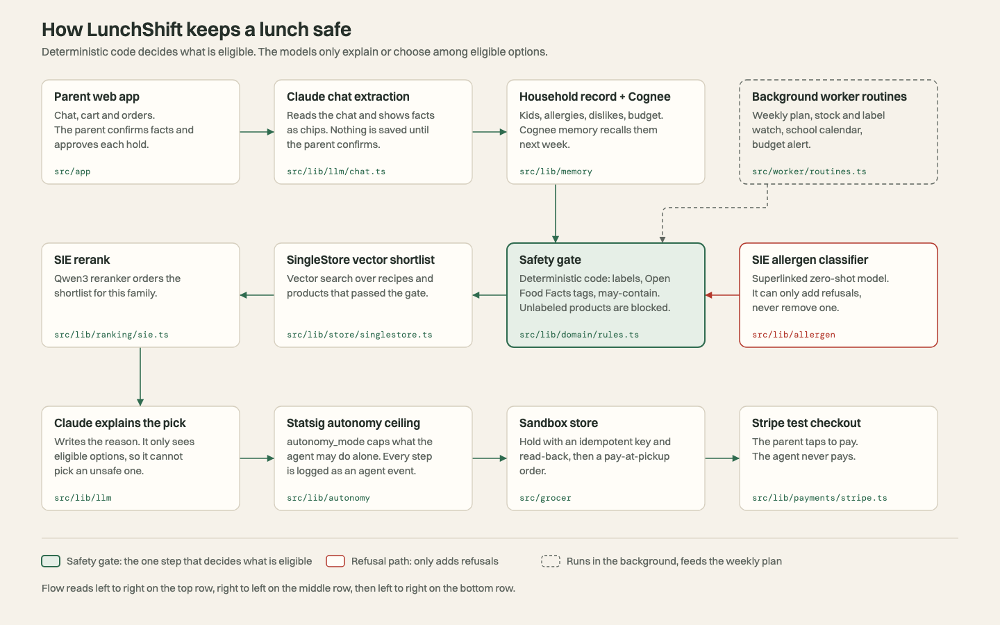

# LunchShift architecture

Rule that shapes everything: deterministic code enforces allergen, budget, stock and mandate rules. The models only explain or choose among options that code has already marked eligible. Numbers from the real runs are in [proof/metrics.json](proof/metrics.json).

**Parent web app** (`src/app`, `src/components`). Chat, cart and orders. The parent confirms facts, approves holds when autonomy is low, and is the only one who can pay.

**Claude chat extraction** (`src/lib/llm/chat.ts`). Reads what the parent types and turns it into facts shown as chips: kids, allergies with cross-contact tolerance, dislikes, budget, store, pickup. Nothing is saved until the parent confirms the chips.

**Household record + Cognee memory** (`src/lib/memory`). Confirmed facts are saved to the household record and to Cognee, so next week's plan recalls them without asking again.

**Safety gate** (`src/lib/domain/rules.ts`, `src/lib/allergen`). Deterministic code. It checks product labels, Open Food Facts tags and may-contain statements against the household's allergies and blocks any product with no label. Tag versus ingredient-text conflicts are covered by the allergen suite.

**Superlinked SIE allergen classifier** (`src/lib/allergen`). A zero-shot model that reads label text beside the gate. It can only add refusals, never remove one the gate made.

**SingleStore vector shortlist** (`src/lib/store/singlestore.ts`). SingleStore is the system of record for the household, recipes, label snapshots, runs and the append-only audit. Ranking stage one is a vector search over the recipes and products that passed the gate.

**SIE rerank** (`src/lib/ranking/sie.ts`). The Qwen3 reranker orders the shortlist for this family. If SIE is down, a labelled fallback ranks instead.

**Claude explains the pick** (`src/lib/llm`). Writes the reason a lunch or swap was chosen. It only sees eligible options, so it cannot pick an unsafe one.

**Statsig autonomy ceiling + agent events** (`src/lib/autonomy`). The `autonomy_mode` setting caps what the agent may do alone: suggest only, swap, or swap and hold. A bad or timed-out config falls back to suggest only. Every step is written as an agent event.

**Sandbox store** (`src/grocer`). Places the hold with an idempotent key and reads it back line by line, then creates a pay-at-pickup order. A dropped reply or a retry never makes a second hold.

**Stripe test checkout** (`src/lib/payments/stripe.ts`). The parent taps to pay in test mode. The agent token cannot pay, and a live key is refused. One PaymentIntent per hold, also on a double tap.

**Background worker routines** (`src/worker/routines.ts`). Weekly plan, stock and label watch, school calendar and budget alert. They run without a parent open and feed the plan step at the safety gate.
